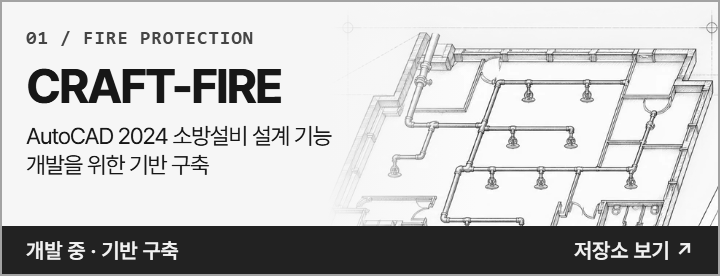
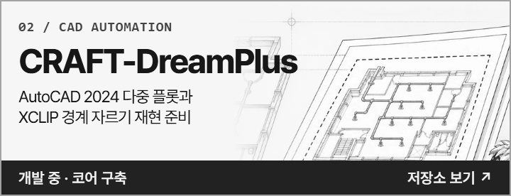

  <a href="https://github.com/Yfacine/CRAFT">
    <picture>
      <source media="(max-width: 600px)" srcset="assets/engineering-overview-compact.webp">
      
    </picture>
  </a>

  
  
  

## 01 / CRAFT부터 시작하기

<strong><a href="https://github.com/Yfacine/CRAFT">CRAFT</a></strong>는 재현할 업무를 정하고, 분석 도구와 에이전트로 구현 계획을 세운 뒤 검증 결과를 기록하는 작업공간입니다.

Windows x64 배포 · 작업 현황판 · 계획 및 검증 양식

## 02 / 진행 중인 프로젝트

  
  

### 재현 후보 · 구현 전

| 저장소 | 재현 대상 업무 |
| :--- | :--- |
| [CRAFT-PyroSim](https://github.com/Yfacine/CRAFT-PyroSim) | 3D 화재·연기 모델과 FDS 해석 입력 준비 |
| [CRAFT-Pathfinder](https://github.com/Yfacine/CRAFT-Pathfinder) | 보행자 이동과 피난 시나리오 비교 |
| [CRAFT-Simulex](https://github.com/Yfacine/CRAFT-Simulex) | 층별 피난 경로와 대피 시간 분석 |
| [CRAFT-Contam](https://github.com/Yfacine/CRAFT-Contam) | 구역 간 공기 흐름과 오염물 이동 분석 |
| [CRAFT-Ventus](https://github.com/Yfacine/CRAFT-Ventus) | 환기·제연 모델링과 풍량·차압 분석 |
| [CRAFT-Pipenet](https://github.com/Yfacine/CRAFT-Pipenet) | 배관망 구성과 유량·압력 해석 |
| [CRAFT-AutoCAD](https://github.com/Yfacine/CRAFT-AutoCAD) | 도면 작성·편집과 반복 작업 |
| [CRAFT-Vehicle-Tracking](https://github.com/Yfacine/CRAFT-Vehicle-Tracking) | 차량 회전 궤적과 통과 공간 검토 |

[CRAFT 재현 후보군 전체 보기 ↗](https://github.com/Yfacine/CRAFT#재현-후보군)

### 그 밖의 공개 저장소

| 저장소 | 주제 |
| :--- | :--- |
| [PASS_AI-FLY](https://github.com/Yfacine/PASS_AI-FLY) | Simulex·Contam 학습 주제 · 소개 문서만 공개 |
| [PASS_AI-MCP](https://github.com/Yfacine/PASS_AI-MCP) | 소개 문서만 공개 |
| [Asta-Profile](https://github.com/Yfacine/Asta-Profile) | 아스타 프로필 이미지 시안 |
