

  <a href="https://github.com/Yfacine/CRAFT">
    <picture>
      <source media="(max-width: 600px)" srcset="assets/engineering-overview-compact.webp">
      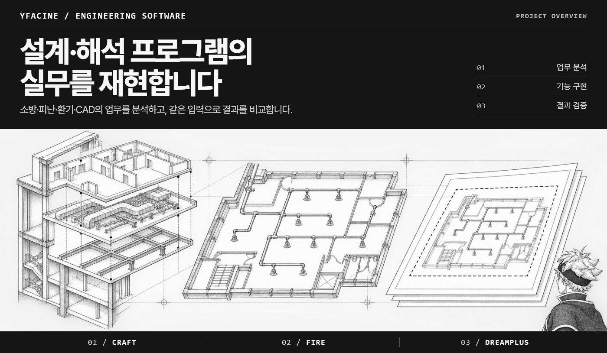
    </picture>
  </a>

  
  
  

## 01 / CRAFT부터 시작하기

<strong><a href="https://github.com/Yfacine/CRAFT">CRAFT</a></strong>는 재현할 업무를 정하고, 분석 도구와 에이전트로 구현 계획을 세운 뒤 검증 결과를 기록하는 작업공간입니다.

Windows x64 배포 · 작업 현황판 · 계획 및 검증 양식

<a href="https://github.com/Yfacine/CRAFT#windows-cli-미리보기">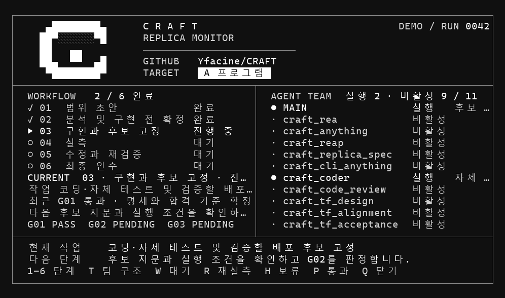</a>

## 02 / CRAFT 프로젝트 · FIRE와 DreamPlus는 기본 안내 공개

  <a href="https://github.com/Yfacine/CRAFT-FIRE">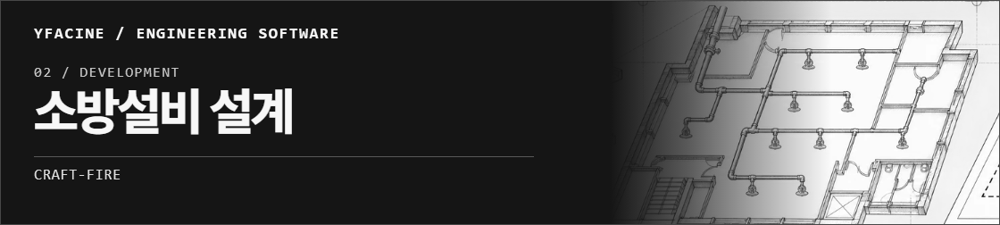</a>
  <a href="https://github.com/Yfacine/CRAFT-DreamPlus">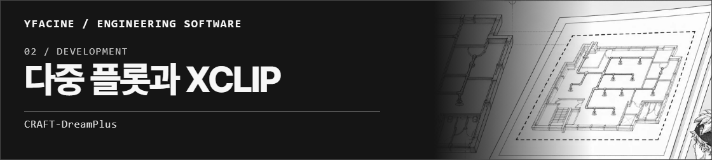</a>

### 재현 후보 · 구현 전

  <a href="https://github.com/Yfacine/CRAFT-PyroSim">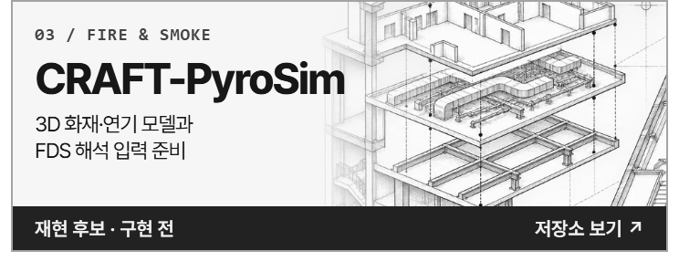</a>
  <a href="https://github.com/Yfacine/CRAFT-Pathfinder">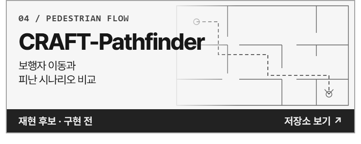</a>
  <a href="https://github.com/Yfacine/CRAFT-Simulex">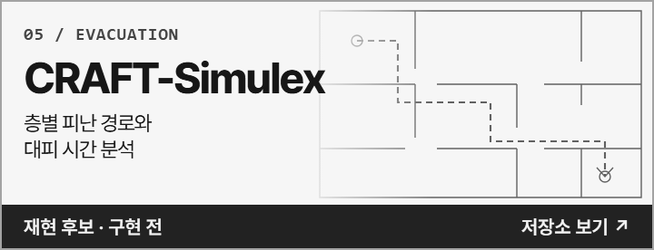</a>
  <a href="https://github.com/Yfacine/CRAFT-Contam">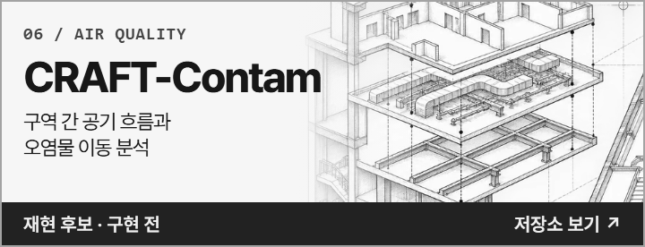</a>
  <a href="https://github.com/Yfacine/CRAFT-Ventus">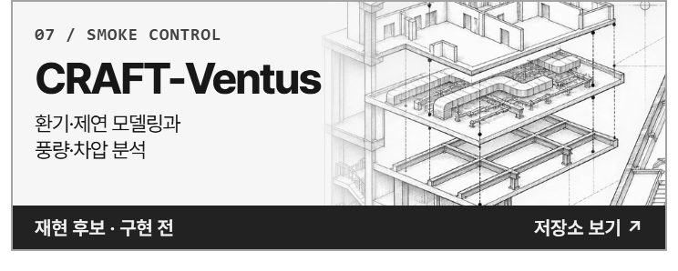</a>
  <a href="https://github.com/Yfacine/CRAFT-Pipenet">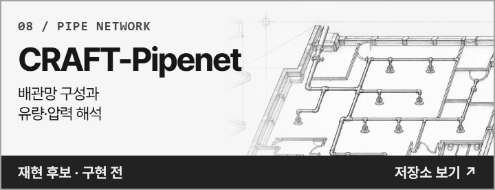</a>
  <a href="https://github.com/Yfacine/CRAFT-AutoCAD">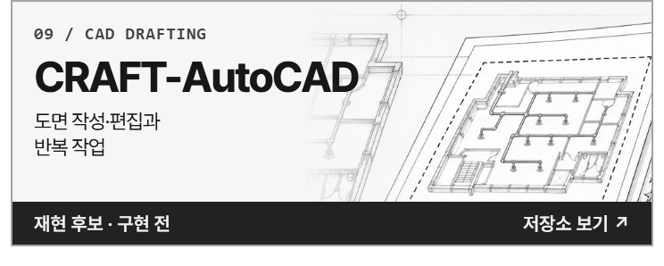</a>
  <a href="https://github.com/Yfacine/CRAFT-Vehicle-Tracking">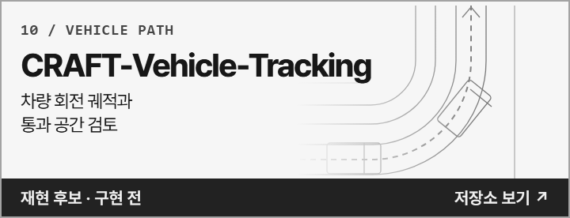</a>

[CRAFT 재현 후보군 전체 보기 ↗](https://github.com/Yfacine/CRAFT#재현-후보군)

### 그 밖의 공개 저장소

  <a href="https://github.com/Yfacine/PASS_AI-FLY">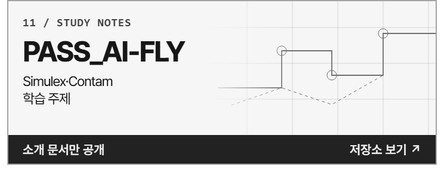</a>
  <a href="https://github.com/Yfacine/PASS_AI-MCP">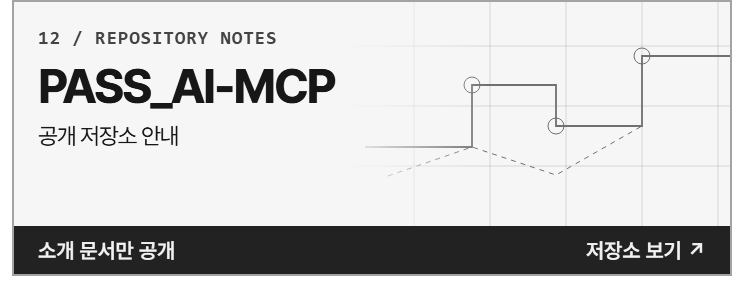</a>
  <a href="https://github.com/Yfacine/Asta-Profile">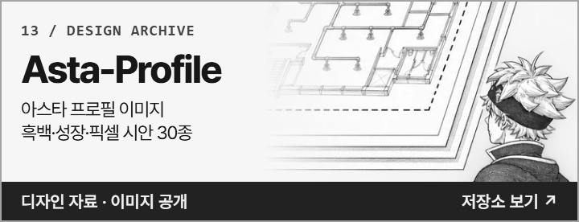</a>

