

  <picture>
    <source media="(max-width: 600px)" srcset="assets/engineering-overview-compact.webp">
    
  </picture>

## 01 / CRAFT 소개

**CRAFT**는 재현할 업무를 정하고, 분석 도구와 에이전트로 구현 계획을 세운 뒤 검증 결과를 기록하는 작업공간입니다. 현재 공개 저장소와 배포 주소는 확인되지 않아 다운로드 링크를 제공하지 않습니다.

Windows x64 배포 이력 · 작업 현황판 · 계획 및 검증 양식

## 02 / CRAFT 프로젝트 현황

### 재현 후보 · 구현 중

### 재현 후보 · 구현 전

아래 후보의 공개 저장소 주소는 현재 확인되지 않아 카드 링크를 연결하지 않았습니다.

  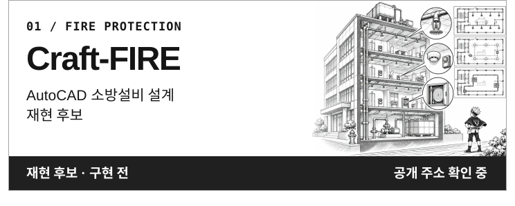
  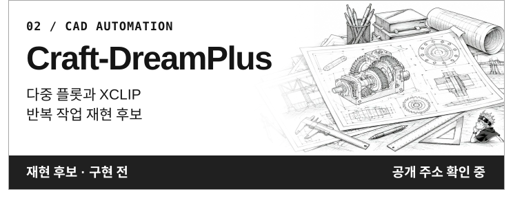
  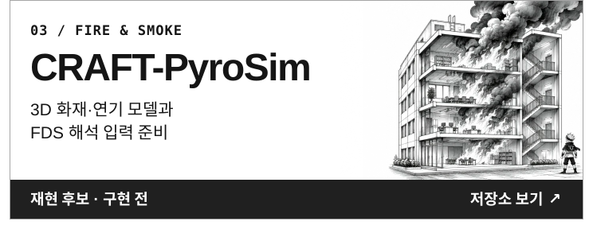
  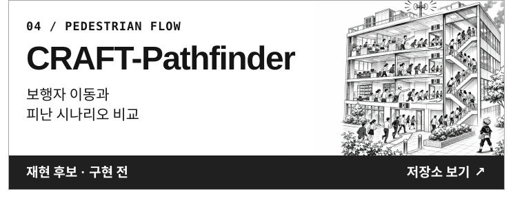
  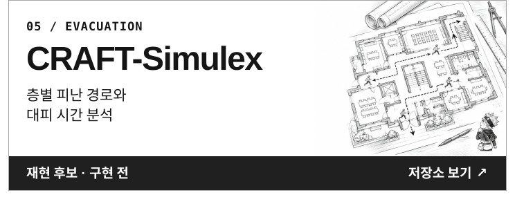
  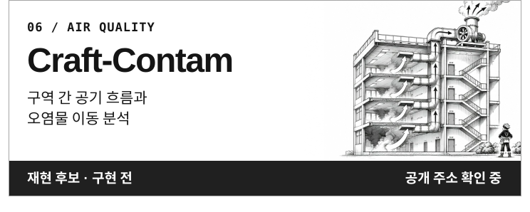
  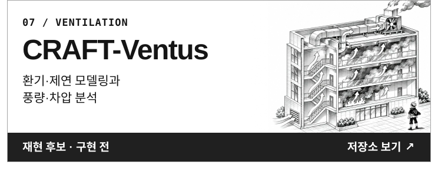
  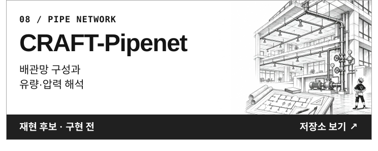
  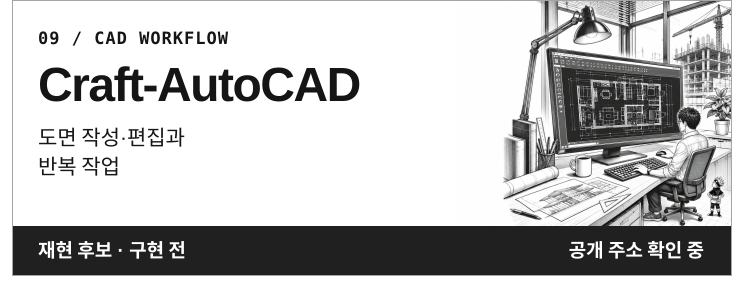
  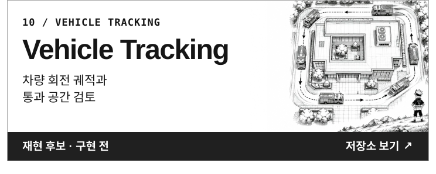

[카드 제작 및 배치 기준 v0.1](docs/card-guidelines.md)

### 그 밖의 공개 저장소

  <a href="https://github.com/Yfacine/PASS_AI-FLY">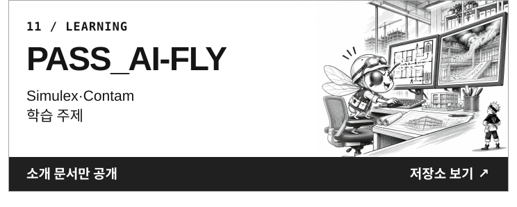</a>
  <a href="https://github.com/Yfacine/PASS_AI-MCP">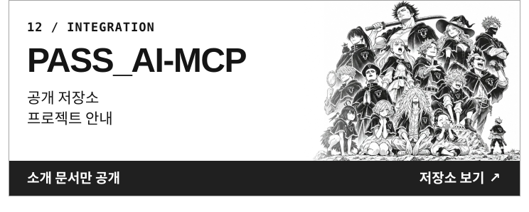</a>
  <a href="https://github.com/Yfacine/Asta-Profile">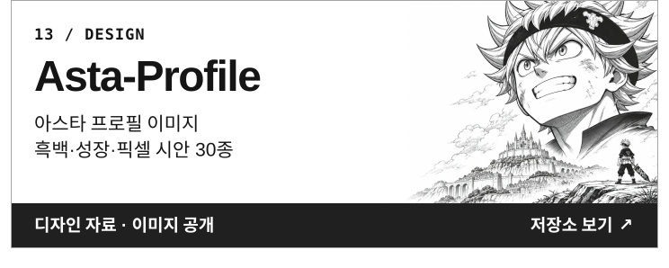</a>

